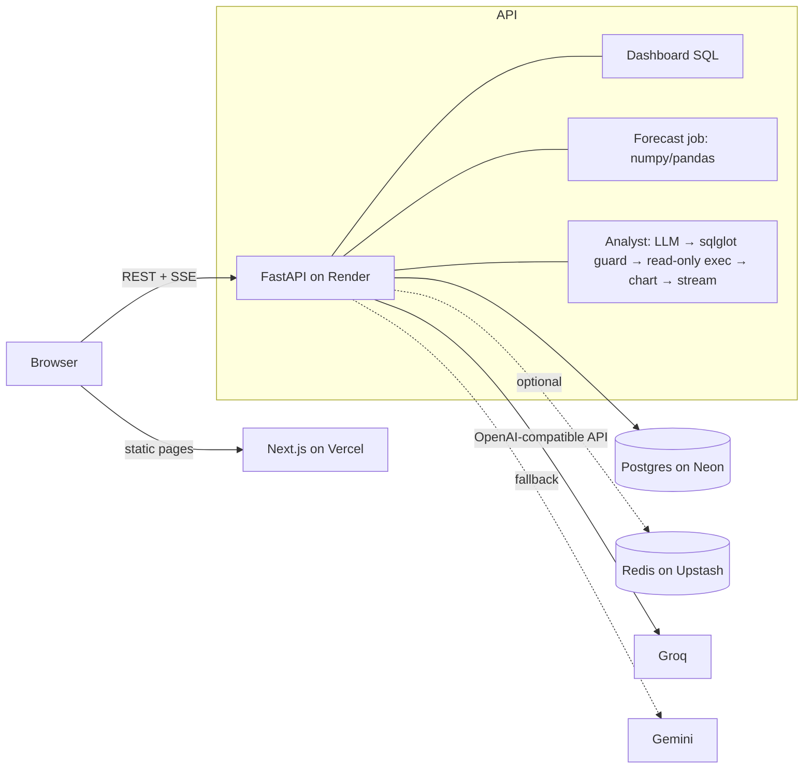

# ShelfDekho

**Retail analytics with promo- and festival-aware demand forecasting, stock-out alerts and an AI analyst that answers business questions with SQL.**

**[Live demo](https://shelfdekho.vercel.app)** · [API docs](https://shelfdekho-api.onrender.com/docs) · no sign-up, one click

> The API runs on a free tier that sleeps when idle. The first visit can take up to a minute while it wakes; the app shows a banner while it does.

<!-- Add a 60-second GIF or Loom walkthrough here: docs/demo.gif -->

## Bringing in new figures

The **Data** screen takes a CSV of daily sales (`date, store, sku, units`, optional `revenue`, `discount`) or a stock count (`store, sku, on_hand`, optional `date`). Each file is checked first, without changing anything, and bad rows are listed by line. Confirming saves the good rows in one transaction, moves stock down by what sold since the last count, and recalculates every forecast. A week still in progress is forecast rather than read as a collapse in demand, and a day counts on the screens once most of the chain has reported it. Stores and SKUs must already exist; new ones are rejected by name.

The public demo sets `DATA_WRITES_ENABLED=false` so every visitor sees the same figures; checking a file still works. The landing page's figures are a bundled snapshot, refreshed with `python -m app.jobs.snapshot`.

## What it does

A category manager at an 8-store Indian grocery chain opens ShelfDekho and sees:

| | |
|---|---|
| **Overview** | Revenue, units, margin and promo share vs last year (weekday-aligned), plus auto-generated insights: *"21 SKUs at risk of stocking out: ₹3.5 L of sales at risk"*, *"Baner, Pune is down 20% vs last year"*, and *"Diwali timing distorts this comparison"* when the festival falls in one year's window but not the other. |
| **Forecast & stock** | An 8-week demand forecast for all 384 store × SKU series, backtested against baselines, combined with on-hand inventory to flag what will run out before a reorder can arrive. |
| **AI analyst** | Ask *"Why did Cola 2L sales dip in Mumbai in May?"* It writes PostgreSQL, validates it, runs it read-only, picks a chart and streams a plain-English answer. In this case, the answer is a two-week stock-out during the heatwave. |

## Results worth talking about

**Forecast accuracy (12-week holdout, 384 series):**

| Method | WAPE |
|---|---|
| **ShelfDekho model** | **17.7%** |
| 4-week moving average | 19.8% |
| Naive (last week) | 23.5% |
| Seasonal naive (same week last year) | 26.3% |

That is **11% lower error than the best baseline**. Week-of-year seasonality alone *lost* to a moving average (20.3% vs 19.6%), because Diwali moves by up to three weeks a year and festive SKUs had 110% error. Two things retail planners always know in advance fixed it:

1. **A festival calendar.** Weeks around Diwali get event-aligned factors instead of week-of-year factors.
2. **The planned promo calendar.** Promo lift is learned per category as a price elasticity, removed from history and re-applied to future promotions. The estimated elasticities match the ones planted in the data (Snacks 2.22 vs 2.2, Personal Care 1.82 vs 1.8).

The model is vectorised numpy (damped Holt smoothing on deseasonalised, promo-adjusted demand) and forecasts all 384 series in about 1 second on a 512 MB instance.

**AI analyst safety, three independent layers:**

1. **AST validation** with `sqlglot`, not keyword matching: a single `SELECT` only, an allow-list of tables, no `SELECT INTO`, row locks, `pg_*` functions or data-modifying CTEs, and an automatic `LIMIT`. Covered by 16 attack-case tests.
2. **A `READ ONLY` transaction with a 5 s `statement_timeout`.** A test proves a `DELETE` fails even if the guard is bypassed.
3. **An optional read-only Postgres role** ([`backend/sql/readonly_role.sql`](backend/sql/readonly_role.sql)).

If generated SQL fails validation or errors in Postgres, the error goes back to the model for **one self-repair attempt**. [`backend/evals/`](backend/evals) holds a 12-question execution-accuracy eval set (`uv run python -m evals.run`).

**Built to survive a public demo:**

- **Suggested questions** run vetted SQL, so the main demo path works even if every LLM provider is down.
- **Provider fallback:** Groq first, then Gemini, through one OpenAI-compatible client.
- **Answer cache** in Postgres. Repeat questions replay instantly and don't count against the quota.
- **Per-visitor rate limits** (5/min, 20/day) with a remaining-quota counter in the UI. Redis-backed when `REDIS_URL` is set, in-memory otherwise.
- **Cold-start handling:** the frontend pings `/health` on load and explains the wait only if it is slow.

## Architecture



| Layer | Choices |
|---|---|
| Frontend | Next.js 16 (App Router), TypeScript, Tailwind CSS v4, TanStack Query, Recharts, Framer Motion |
| Backend | FastAPI (async), SQLAlchemy 2 + asyncpg, Alembic, Pydantic v2, PyJWT |
| Data & ML | PostgreSQL, pandas, numpy, sqlglot |
| AI | Groq / Gemini via an OpenAI-compatible client, server-sent events |
| Quality | pytest (64 tests against real Postgres), ruff, ESLint, `tsc`, GitHub Actions |
| Contract | TypeScript types are generated from FastAPI's OpenAPI schema; CI fails if they drift |
| Ops | Docker, Render blueprint, structured JSON logs with request IDs, `/health` |

### Project layout

```
backend/
  app/
    routers/          HTTP layer: auth, dashboard, forecast, analyst (SSE)
    services/
      dashboard.py    KPI, trend and breakdown SQL + insight generation
      forecasting.py  promo/festival-aware model + backtest (pure numpy)
      inventory.py    days of cover, stock-out and overstock classification
      analyst.py      text-to-SQL pipeline, vetted suggestions, cache
      sql_guard.py    AST validation of generated SQL
      llm.py          provider fallback, JSON mode, streaming
      synthetic.py    deterministic 2-year dataset with planted stories
    jobs/             seed, forecast, bootstrap (run on container start)
  alembic/            migrations
  evals/              text-to-SQL eval set and runner
  tests/
frontend/
  src/app/            landing, (app)/dashboard, forecast, analyst
  src/lib/            typed API client, SSE reader, ₹ formatting
```

## The data

The data is synthetic and deterministic (seed 42), so there are no licensing questions and the numbers are reproducible. It covers two years of daily sales (280k rows) for 8 stores × 48 SKUs across six categories, with the structure real retail data has:

- **Seasonality:** a moving Diwali spike, summer drinks and sunscreen, monsoon mosquito repellent, winter lotion
- **Weekly pattern:** weekend peaks
- **Promotions:** chain-wide promotions with category elasticities and a post-promo pantry-loading dip
- **Planted stories for the analyst to find:** a competitor opening near Pune Baner in March 2026, fast growth at a new Hyderabad Express store, and supply-chain stock-outs

## Deploy for free

1. **Database:** create a Neon project and copy the *direct* connection string.
2. **API:** in Render, choose New → Blueprint and pick this repo ([`render.yaml`](render.yaml)). Set `DATABASE_URL`, `CORS_ORIGINS` (your Vercel URL) and `GROQ_API_KEY` / `GEMINI_API_KEY`. On first boot the container runs migrations, seeds the data and computes forecasts (about 30 s).
3. **Frontend:** import the repo in Vercel with root directory `frontend`, and set `NEXT_PUBLIC_API_URL` to the Render URL and `NEXT_PUBLIC_REPO_URL` to this repo.
4. **Optional:** run [`backend/sql/readonly_role.sql`](backend/sql/readonly_role.sql) in Neon and set `ANALYST_DATABASE_URL`, and add an Upstash Redis URL as `REDIS_URL`.

## Trade-offs and next steps

- **Forecasting:** a gradient-boosted model with price, holiday and weather features would likely beat this model, but it would cost the "runs in 1 s on a free instance" property. The backtest harness makes that comparison a one-function change.
- **Auth:** a one-click demo JWT, not real accounts. Next would be OAuth plus role-based access (analyst vs viewer) and row-level filtering by region.
- **Scale:** dashboard queries hit the fact table directly, which is fine at 280k rows. At tens of millions of rows the next step is a daily rollup table or materialized views.
- **Analyst:** add semantic retrieval of example queries (few-shot RAG) and grow the eval set from logged real questions (`ai_query_log`).
